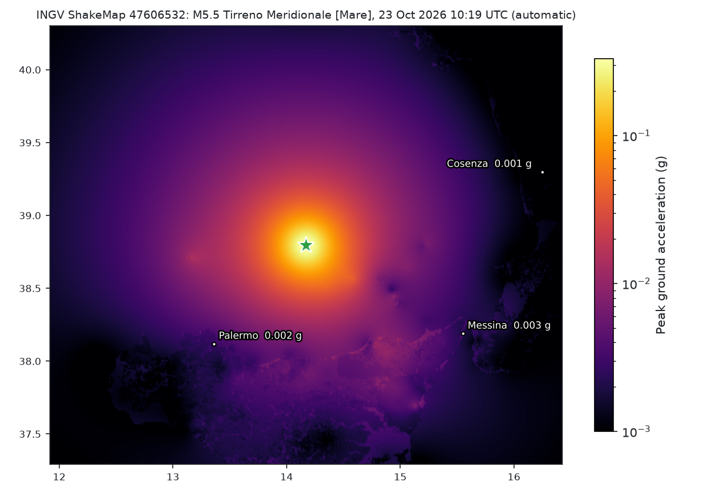
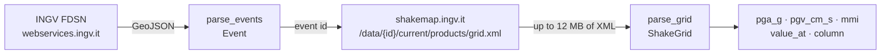

# ingv-shakemap

**How hard did the ground shake here?** INGV's earthquakes and ShakeMap grids,
read into numbers you can sample at any point in Italy.

[](https://github.com/agent-engineering-studio/ingv-shakemap/actions/workflows/ci.yml)
[](https://pypi.org/project/ingv-shakemap/)
[](https://agentengineering.it/ingv-shakemap/)


[](https://github.com/agent-engineering-studio/ingv-shakemap/blob/main/LICENSE)

```python
grid = await IngvClient().shakemap(47606532)
grid.pga_g(15.55, 38.19)  # 0.0029 g in Messina, from the Mw 5.5 of 23 October 2026
```

<picture>
  <source media="(prefers-color-scheme: dark)" srcset="https://raw.githubusercontent.com/agent-engineering-studio/ingv-shakemap/main/docs/images/pga-dark.png">
  
</picture>
<sub>The ShakeMap of the Mw 5.5 in the southern Tyrrhenian, 23 October 2026, drawn by
<a href="https://github.com/agent-engineering-studio/ingv-shakemap/blob/main/docs/make_images.py"><code>docs/make_images.py</code></a> with this package: 542 × 362 points, peak 0.33 g.</sub>

- [What is it, in 30 seconds](#what-is-it-in-30-seconds)
- [Who is it for](#who-is-it-for)
- [Quick start](#quick-start)
- [How it works](#how-it-works)
- [Recipes](#recipes)
- [The traps we already fell into](#the-traps-we-already-fell-into)
- [API at a glance](#api-at-a-glance)
- [Data licence and credits](#data-licence-and-credits)

## What is it, in 30 seconds

After every significant earthquake INGV publishes a **ShakeMap**: its estimate
of how strongly the ground shook at every point around the epicentre, built from
the stations that recorded it and from ground-motion models where there are
none. The map is a `grid.xml` of up to 12 MB of text. This package turns it into
arrays and answers questions about a point.

| | What you get |
|---|---|
| 🌍 | **Earthquakes** from the INGV FDSN catalogue: id, time (UTC), magnitude and its type, epicentre, depth, place |
| 📈 | **The ShakeMap grid** of an event: PGA, PGV, MMI, spectral accelerations, Vs30, as `numpy` arrays |
| 📍 | **The value at a point**: `pga_g(lon, lat)` in g, `pgv_cm_s`, `mmi`, or any column with `value_at` |
| 🧾 | **The map's own metadata**: version, `map_status` (`automatic` until reviewed), processing time |
| 🔌 | **Your HTTP layer**: inject an `httpx.AsyncClient`, or route every call through your own `send` |
| 🧪 | **Pure parsers**: `parse_grid` and `parse_events` do no I/O, so you can test them on a file |

## Who is it for

- Anyone who needs **shaking at a site**, not just a magnitude: a building, a
  dam, a road, the cells of a hazard model. Magnitude says how big the
  earthquake was; PGA says how hard it hit *here*.
- Landslide and multi-hazard models: earthquake-triggered landslides scale with
  ground acceleration, which this gives per point.
- Researchers and journalists who want INGV's own estimate rather than a
  distance-based guess.

It was extracted from [Limen](https://github.com/agent-engineering-studio/limen),
the landslide, flood and wildfire monitor for Italy, where it reads the
ShakeMap of every earthquake above magnitude 3.5 onto a 1 km grid. On three
real grids its PGA matches Limen's own parser value for value.

## Quick start

```bash
pip install ingv-shakemap
```

```python
import asyncio
from datetime import UTC, datetime

from ingv_shakemap import IngvClient


async def main() -> None:
    async with IngvClient() as ingv:
        quakes = await ingv.events(
            datetime(2026, 10, 23, tzinfo=UTC),
            datetime(2026, 10, 24, tzinfo=UTC),
            min_magnitude=4.5,
        )
        for q in quakes:
            print(q.id, q.time, q.magnitude, q.magnitude_type, q.place)

        grid = await ingv.shakemap(quakes[1].id)  # None if INGV published no map
        if grid is not None:
            print(grid.map_status, grid.pga_g(15.55, 38.19), grid.mmi(15.55, 38.19))


asyncio.run(main())
```

```text
47611152 2026-10-23 13:55:34.920000+00:00 5.0 Mw Tirreno Meridionale [Mare]
47606532 2026-10-23 10:19:15.470000+00:00 5.5 Mw Tirreno Meridionale [Mare]
47605832 2026-10-23 09:51:38.850000+00:00 4.8 Mw Tirreno Meridionale [Mare]
automatic 0.002939 3.4
```

## How it works



The FDSN event id is the ShakeMap id: the same integer joins the two services.

## Recipes

**The shaking on many points at once.** `column` gives the whole grid as an
`(nlat, nlon)` array, north row first; index it yourself for thousands of points:

```python
pga = grid.column("PGA") / 100.0  # percent of g -> g
west, south, east, north = grid.bbox
```

**Parse in a thread.** A big grid takes about a quarter of a second to parse.
`IngvClient.shakemap` already runs it in `asyncio.to_thread`; when you parse
yourself, do the same:

```python
xml = await ingv.shakemap_xml(event_id)
grid = await asyncio.to_thread(parse_grid, xml)
```

**Your own HTTP layer.** Pass `send`, and the client uses it for every request
and does no retrying of its own:

```python
async def send(method: str, url: str, **kwargs):
    return await my_shared_policy(method, url, **kwargs)


ingv = IngvClient(send=send)
```

**No network at all.** `parse_grid(Path("grid.xml").read_bytes())` and
`parse_events(json.loads(text))` work on files.

## The traps we already fell into

1. **PGA is in percent of g, not in g.** The `grid.xml` writes `units="%g"`:
   `0.11` is 0.0011 g, barely felt. `pga_g` converts; `value_at("PGA", ...)`
   and `column("PGA")` return the file's own unit.
2. **The row order is a convention, not a statement.** Rows go from the north
   edge southwards, longitude fastest. `parse_grid` checks this on the first
   rows and refuses a file in another order, because a wrong guess would move
   every value without raising.
3. **The grid step changes from event to event**: about 90 m at Campi Flegrei,
   0.0083° (about 900 m) for the 23 October 2026 sequence. Never hard-code it;
   read `lon_step` and `lat_step`.
4. **An empty week is a 204, an outage is not.** The FDSN service answers
   `204 No Content` to a window without earthquakes. A 5xx, even with no body,
   is a failure: `events` raises `IngvError` for it and returns `[]` only for
   the 204, so an unreachable catalogue never looks like a quiet week.
5. **No ShakeMap is a 404, and it is normal.** Small or very recent events
   have none: `shakemap` returns `None`. Any other error raises.
6. **`automatic` can last.** The maps of the 23 October 2026 sequence still
   said `map_status="automatic"` twelve days later. Read `map_status` and
   `process_time` if you need a reviewed map, and fetch it again later.
7. **The old URL is dead.** The `/shake4/` prefix answered 404 for every event
   on 19 October 2026; the grid lives under `/data/{id}/current/products/`.
8. **No top-level id in the GeoJSON.** INGV puts the event id in
   `properties.eventId`, as an integer. `parse_event` reads it from there.
9. **Times are UTC without an offset**, both ways. The package sends
   `2026-10-23T10:19:15` and gives back aware UTC datetimes.

## API at a glance

| Name | What it does |
|---|---|
| `IngvClient(client=None, *, send=None, retries=3, backoff_s=2.0, timeout_s=60.0)` | async client; retries transport errors, 429 and 5xx |
| `IngvClient.events(start, end, *, bbox=ITALY, min_magnitude=None, max_depth_km=None, limit=None)` | earthquakes, newest first |
| `IngvClient.shakemap(event_id)` / `.shakemap_xml(event_id)` | the parsed grid, or the raw bytes; `None` if there is no map |
| `parse_grid(xml)` → `ShakeGrid` | pure parser; raises only `GridError` |
| `ShakeGrid.pga_g` / `.pgv_cm_s` / `.mmi` / `.value_at` / `.column` / `.bbox` | values at a point, or as arrays |
| `ShakeGrid.event`, `.map_status`, `.version`, `.process_time`, `.fields` | the map's metadata |
| `parse_events(geojson)` / `parse_event(feature)` → `Event` | pure parsers of the FDSN answer |
| `event_query(...)`, `shakemap_grid_url(id)` | the requests, without sending them |
| `IngvError`, `GridError` | the only exceptions; `GridError` is also a `ValueError` |

The full reference is on the [documentation site](https://agentengineering.it/ingv-shakemap/).

## Development

```bash
uv sync
make check   # ruff, mypy --strict, pytest with coverage
make docs    # the documentation site, built with --strict
```

## Data licence and credits

- **Earthquake catalogue:** © Istituto Nazionale di Geofisica e Vulcanologia
  (INGV). The data and results published on
  [terremoti.ingv.it](https://terremoti.ingv.it/en) are under
  [CC BY 4.0](https://creativecommons.org/licenses/by/4.0/): credit INGV.
- **ShakeMap:** computed and published by INGV at
  [shakemap.ingv.it](https://shakemap.ingv.it/). That site states no licence of
  its own (checked on 4 November 2026); credit INGV as for the catalogue.
- ShakeMap is software by the USGS; the `grid.xml` format is ShakeMap 4's.

This package is not affiliated with INGV or the USGS. Code under
[Apache-2.0](https://github.com/agent-engineering-studio/ingv-shakemap/blob/main/LICENSE).
